## Box Score

8/12 紅人 0:5 白襪 (F/9)

[ESPN Box](https://www.espn.com/mlb/game/_/gameId/401816501/reds-white-sox)

## Story

開學前一個禮拜回到芝加哥玩，解鎖兩個算是離學校最近的球場。朋友說 Illinois 的學生有時候可以在一個網站買到白襪的學生票，剛好我去看得這場有賣，所以讓我利用到剛去學校辦好的學生證買到 <10 美的上層看台票。同時這天也剛好是我 21 歲生日，就以自己一個人在球場度過了。

## 球場印象

以往白襪算是出了名的爛隊，但今年成績很好，我去的這天球迷也不少。之前聽說白襪球場可以買別的地方的票然後去做內野隨便一個位置，但我來得這天管制的比較嚴就沒辦法了。

芝加哥的兩個球場都在捷運站旁邊，好處是交通非常方便，壞處是散場的時候非常擠，甚至兩個球場是在同一條捷運線上，可以想像如果兩地同時散場那捷運負載該有多恐怖。

白襪球場在城市的南邊，算是相對比較荒涼一點的地方，球場附近也比較沒有 baseball village 等商業設施，再往南就是幫派勢力聚集的區域。

我是從三壘側的入口進入，這裡的一樓入口處旁邊就是球隊商店。商店裡面還算寬敞，東西不多但也不會人擠人。

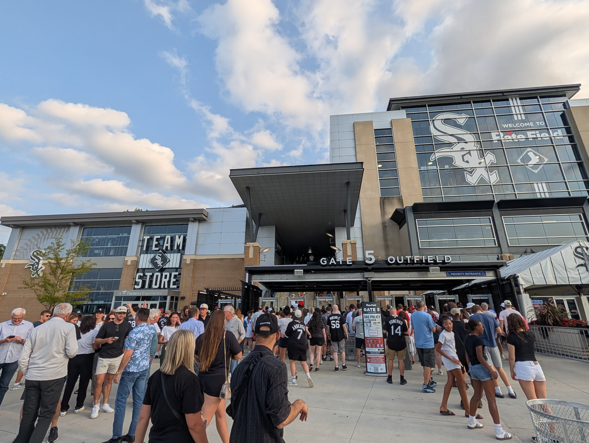

剛好用圖來說明這個球場設計比較神人的地方。在球場本體（包含球場、走道、以及另一側的攤位）是沒有樓梯或手扶梯的，只有殘障用的電梯。換句話說如果你想用電梯以外的方式從樓上走到樓下，就需要穿越空橋到球場外圍一圈的建築，以三壘為例的話就是球隊商店上方的手扶梯和樓梯，才能上下樓。

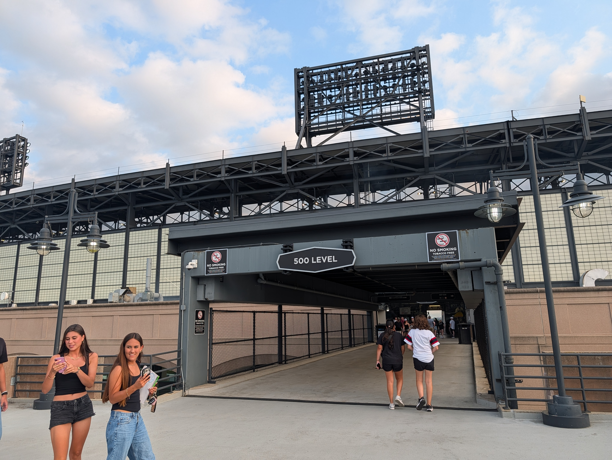

這些「樓梯專用」的建築也有一些特色，包含 southside 和 Chicago 之類的拍照點，但這裡離市區還是有點距離加上這天雲比較多，所以城市天際線的 view 沒有太好看。

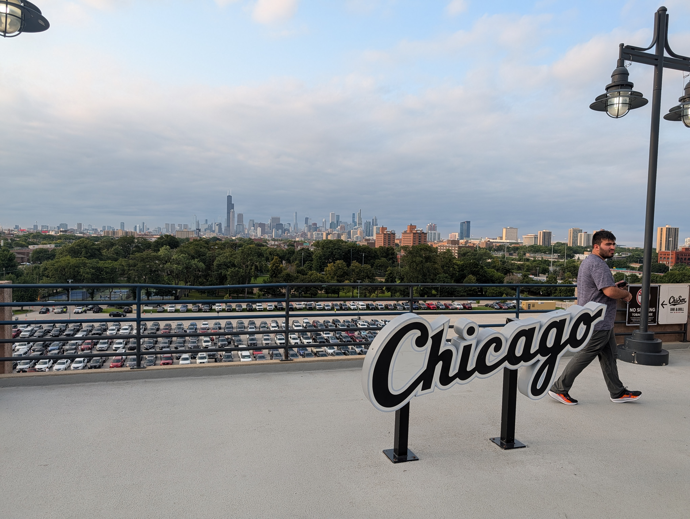
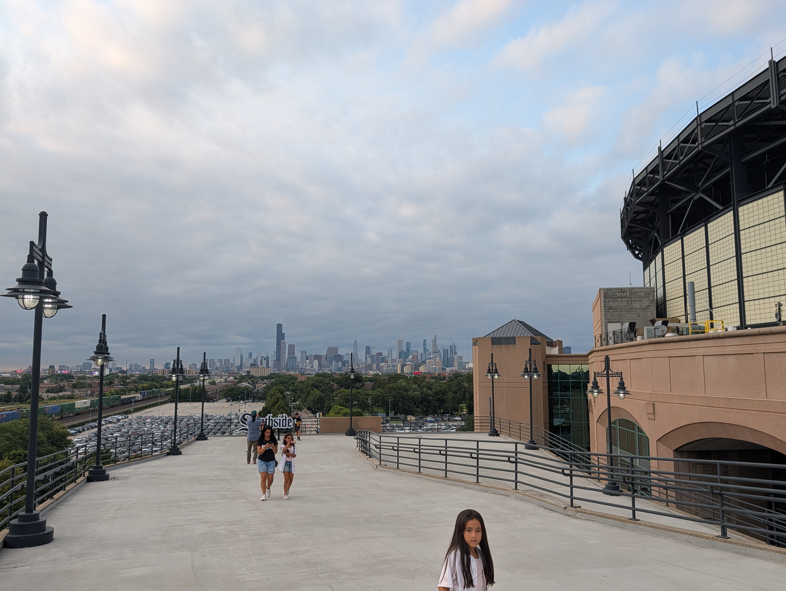

另外第二個神人的點就是這裡頂樓的攤販沒有賣 souvenir soda，我猜是因為平常頂樓根本不開放所以賣的東西本來就很有限。結合第一點就是我在球賽開始前十分鐘時從樓上打算買 souvenir soda，結果需要花 20 分鐘走到樓下買，加上等餐的時間，回到座位時已經打到第二局了。

計分板，豐富度偏低

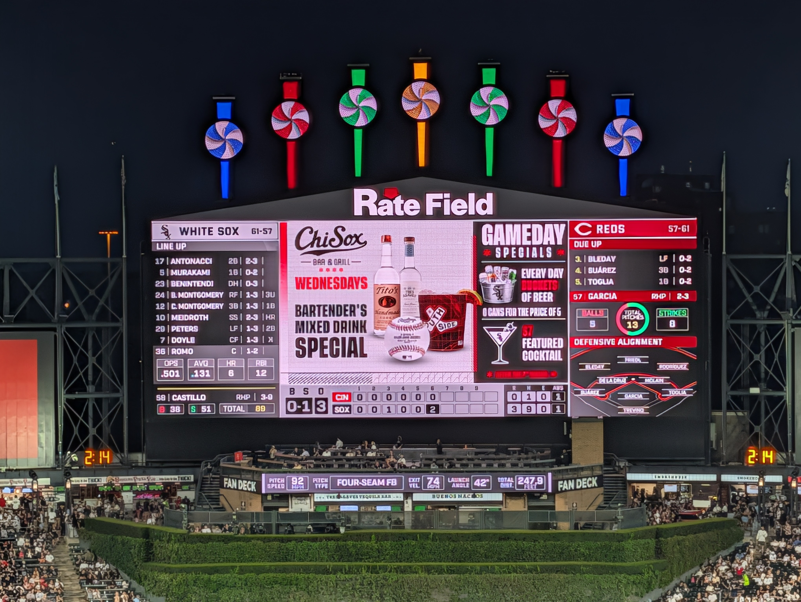

這球場唯一的特點大概就是記分板上面的 windmill 設計了，另外就是我一直以來都很喜歡的開放式設計（走道可以直接看到球場裡面），這裡的外野走道除了打者之眼外幾乎沒有任何遮蔽物。

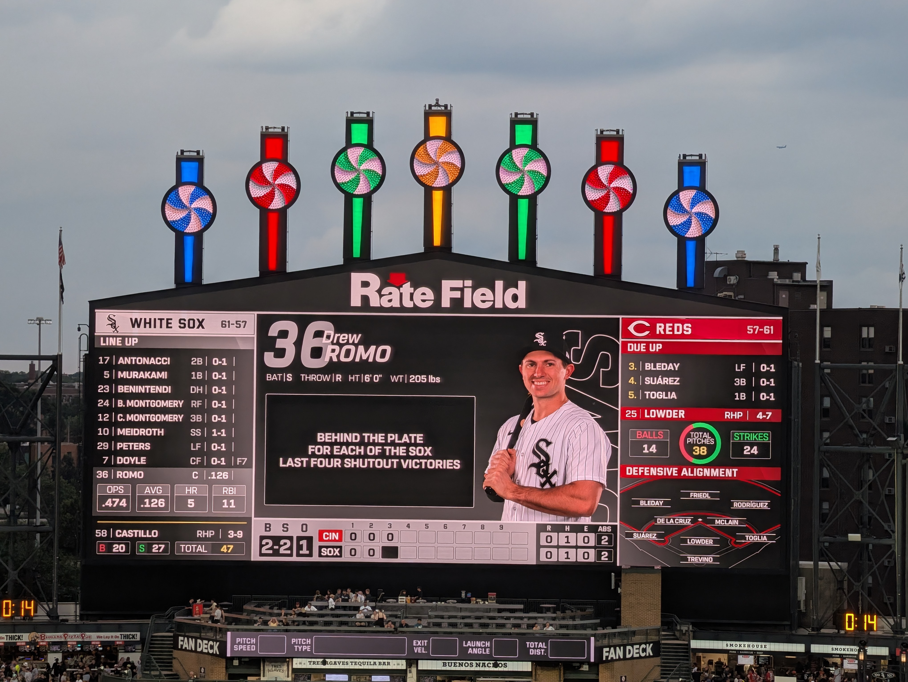
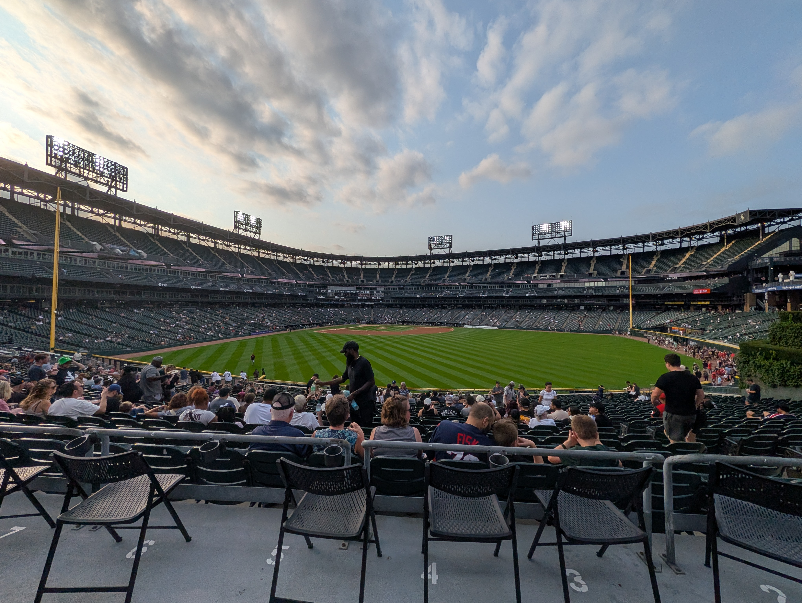
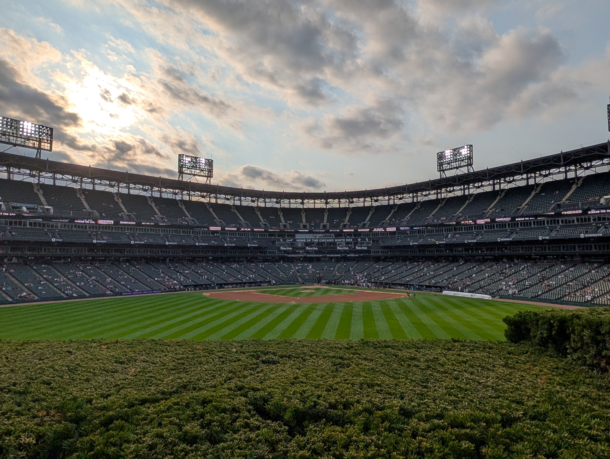

座位視角

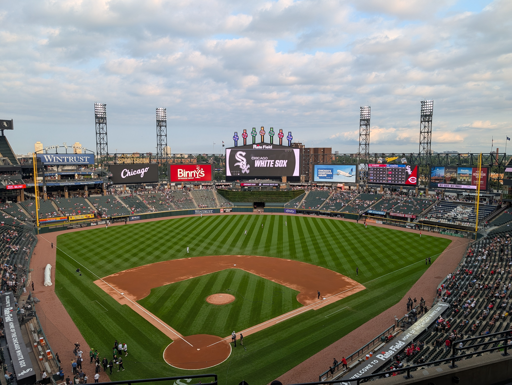
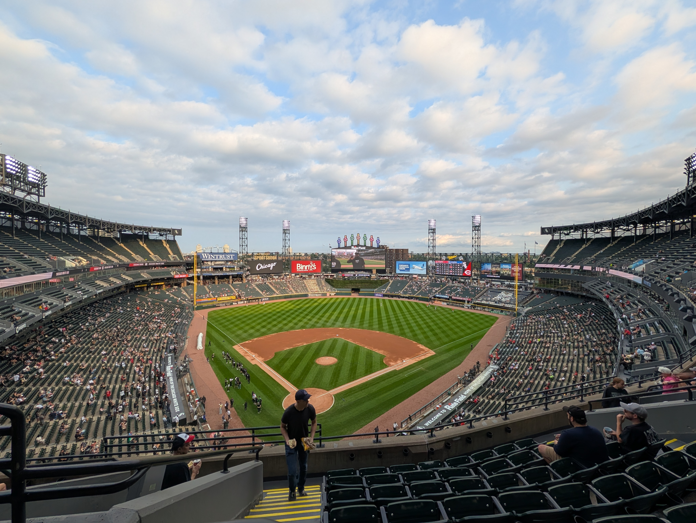
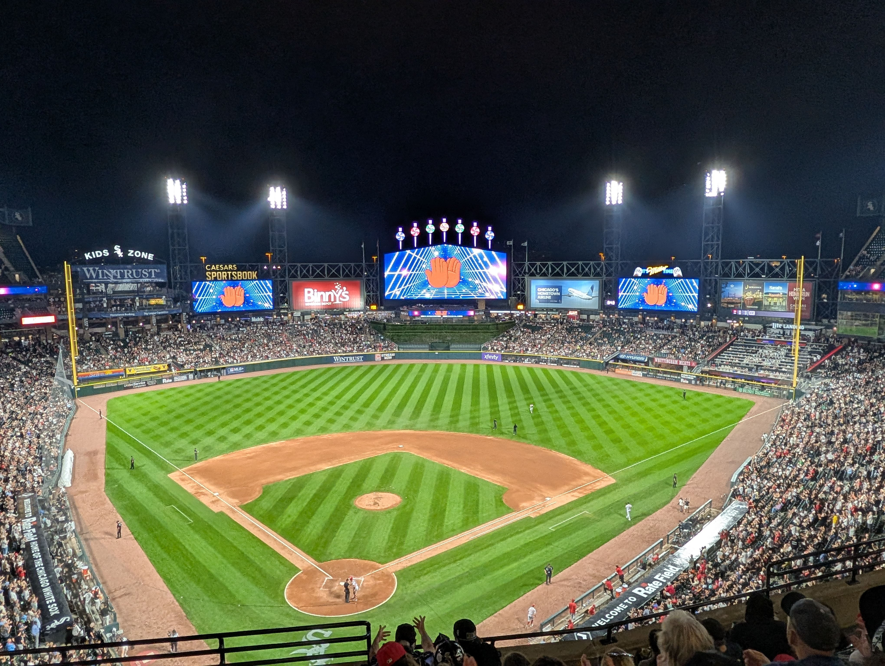

## 比賽內容

這場完全是 Luis Castillo 的個人秀，轉隊後的第一場先發，7 局 10K 2BB 只被打一支安打（被打的時候我還在走樓梯，所以對我來說可以算是無安打了），加上上次看西雅圖對太空人那場，我看 Castillo 的成績是 13.2 IP 4H 17K，結果他在白襪也只有這場投得好而已，這場還在 fantasy 2/3 盟的對手手上。

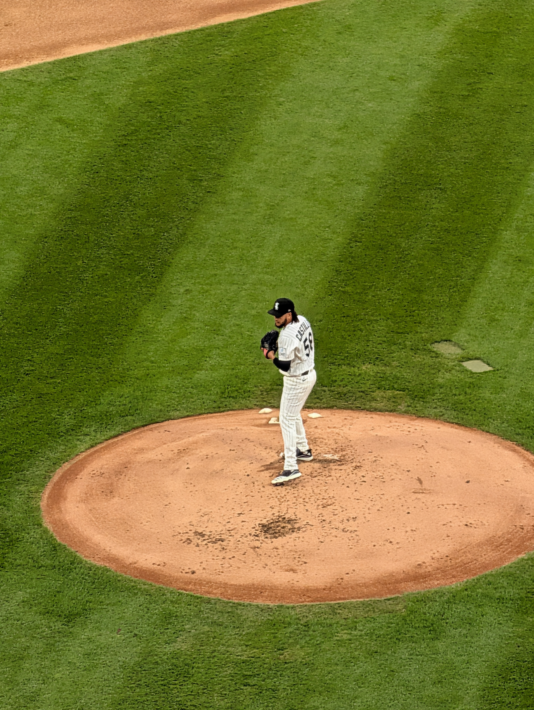

白襪對 Lowder 打得普普通通，Drew Romo 炸了一發陽春砲，完全意想不到的人；另外全壘打的時候有煙火，算是少數的亮點

後面 Meidroth 對紅人後援 Garcia 炸了兩分砲，Garcia 上來的時候我看他數據就想說這個人的運氣也太誇張好，結果直接校正一波；8 局紅人 Marinaccio 上來自爆把比分拉開到沒有終結者登場特效的分數，雖然後面白襪還是換上 Brazoban (那時候他應該算終結者吧)，但也沒有特效。另外白襪的 Hagen Smith 感覺有點強，這裡先用文字投資一下。最後紅人 Stewart 打出本場第二安，也是唯一一個有安打的紅人打者。

## 綜合球場評價

妥妥的 T5 級球場，跟國民的不相上下，都算是沒什麼特色的球場，共同的好處是外野都是一體成形。另外最大的優點應該就是便宜吧XD。